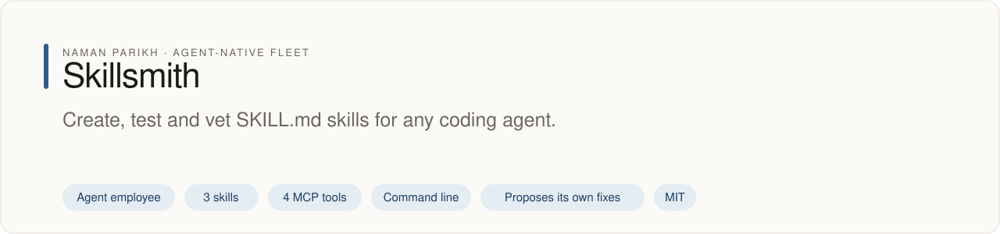

# Skillsmith

<!-- fleet:header:start -->
<p align="center"><picture><source media="(prefers-color-scheme: dark)" srcset="assets/banner-dark.svg"></picture></p>

<p align="center">
<a href="https://github.com/naman10parikh/skillsmith/actions/workflows/ci.yml"></a>
<a href="https://github.com/naman10parikh/skillsmith/releases"></a>
<a href="LICENSE"></a>
<a href="#use-it-from-any-coding-agent"></a>
<a href="https://x.com/naman10parikh"></a>
<a href="https://www.linkedin.com/in/naman-parikh1/"></a>
</p>

<p align="center"><a href="#quick-start">Quick start</a> · <a href="docs/README.md">How it works</a> · <a href="AGENTS.md">AGENTS.md</a> · <a href="llms.txt">llms.txt</a> · <a href="skills/">Skills</a> · <a href="https://github.com/naman10parikh/skillsmith/discussions">Discussions</a> · <a href="https://github.com/naman10parikh">All projects</a></p>

**Create, test and vet SKILL.md skills for any coding agent.**

Skillsmith is an agent employee, a packaged specialist agent with its own skills, memory and tests. It owns one job: skills. Coding agents use it through its skills, its MCP server and its command line. A scheduled job runs its evals and proposes fixes. A person makes every change.

_Skillsmith is part of an agent-native play for agent-native systems that can eventually be recursively self-improving and evolving, operated by agent employees._

<p align="center"></p>
<!-- fleet:header:end -->

Skillsmith (`skillsmith`) helps you write Agent Skills: the `SKILL.md` files that Claude Code,
Gemini CLI, Codex and other coding agents load when a task matches. It scaffolds a skill, checks it
against the rules agents rely on, and checks a skill you did not write inside a throwaway E2B microVM
before you install it. It needs no API key, except `E2B_API_KEY` for that sandbox check.

<!-- fleet:use:start -->
## Use it from any coding agent

**Claude Code**: the plugin brings the skills, sub-agents, hooks and MCP server.

```
/plugin marketplace add naman10parikh/skillsmith
/plugin install skillsmith@skillsmith
```

<details><summary>Its MCP server, Codex, Cursor, Gemini CLI, one skill and the command line</summary>

**Its MCP server**, in any MCP client:

```bash
claude mcp add --transport stdio skillsmith -- npx -y -p github:naman10parikh/skillsmith skillsmith-mcp
codex mcp add skillsmith -- npx -y -p github:naman10parikh/skillsmith skillsmith-mcp
```

Cursor (`.cursor/mcp.json`), Gemini CLI (`.gemini/settings.json`) and most other clients take the same command as JSON:

```json
{
  "mcpServers": {
    "skillsmith": {
      "command": "npx",
      "args": [
        "-y",
        "-p",
        "github:naman10parikh/skillsmith",
        "skillsmith-mcp"
      ]
    }
  }
}
```

**Gemini CLI**: the extension brings the context and the MCP server.

```bash
gemini extensions install https://github.com/naman10parikh/skillsmith
```

**One skill** (3 in all, in [skills/](skills/)), in any agent that reads Agent Skills:

```bash
gemini skills install https://github.com/naman10parikh/skillsmith --path skills/write-a-skill
git clone --depth 1 https://github.com/naman10parikh/skillsmith /tmp/skillsmith && cp -r /tmp/skillsmith/skills/write-a-skill ~/.claude/skills/
```

**The command line:**

```bash
npx -y -p github:naman10parikh/skillsmith skillsmith --help
```

</details>

Codex, Cursor, OpenCode, GitHub Copilot and other agents read [AGENTS.md](AGENTS.md); Claude Code reads [CLAUDE.md](CLAUDE.md) and Gemini CLI reads [GEMINI.md](GEMINI.md), which import it. [llms.txt](llms.txt) maps every surface for agents that read first.
<!-- fleet:use:end -->

## Quick start

It needs Node.js 18 or later. The npm name `skillsmith` belongs to a different project, so run it
from GitHub. One alias keeps the commands short:

```bash
alias skillsmith='npx -y -p github:naman10parikh/skillsmith skillsmith'
skillsmith init changelog-entry
#   ✓ SKILL.md
#   ✓ skillsmith.json
skillsmith test changelog-entry --strict
#   ✓ All 11 checks passed!
```

Point it at a skill someone else wrote, and it names what would stop an agent from using it:

```bash
skillsmith test old-skill
#   ✗ Has frontmatter (name, description)
#   ✗ No hardcoded paths
#   ✗ 2 error(s), 2 warning(s), 7 passed
```

Check a downloaded skill inside an E2B microVM before you install it (needs `E2B_API_KEY`):

```bash
skillsmith sandbox-run ./downloaded-skill
#   ✓ frontmatter, title, trigger, steps, tokens, paths
#   ✓ Skill validated in isolation (571ms)
```

## How it works

An agent decides whether to load a skill from one line: the `description` in its YAML frontmatter.
Then it follows the body. So a skill fails in two ways: the agent never finds it, or finds it and
cannot follow it. `skillsmith test` checks for both:

| Check | If it fails |
| --- | --- |
| Frontmatter with `name` and `description` | Error: agents cannot find the skill |
| A title, a trigger section (`## When to Use`), a steps section (`## Steps`) | Error: agents cannot follow it |
| No absolute paths from one machine (such as a home folder) | Error: it breaks on every other machine |
| Under 2,000 words | Warning, and an error over 3,000 |
| An example and an output section, no empty sections | Warning |

`--strict` turns warnings into failures, and `--json` gives a result a script can read; both exit 1
when the skill fails. The same checks run in four places: the CLI, the MCP server (for agents that
check a draft before saving it), a Claude Code hook (it fires after an agent writes a `SKILL.md`)
and `sandbox-run` (inside an E2B microVM, for text you do not trust). The golden evals fail the build
if the first three disagree.

`init` writes skills that pass `test --strict` from the start. The shared registry is not live yet.
`install` writes a self-contained starter skill from a built-in catalog of 12 starter skills. The catalog is
one list, in [src/catalog.ts](src/catalog.ts): `list`, `install` and the MCP tool `skillsmith_list` all
read it. `publish` validates a skill and explains how to share it through GitHub. `init`, `publish`,
`install` and `sandbox-run` append one line per run to `~/.skillsmith/runs.jsonl`: the command, whether it
worked and how long it took.

### Every command

```bash
skillsmith init [name] [-t basic|advanced|mcp]   # scaffold a skill folder
skillsmith test [path] [--strict] [--json]       # check a skill folder or SKILL.md
skillsmith sandbox-run [path] [--json]           # the same checks inside an E2B microVM
skillsmith install <name> [-g] [--dir path]      # a starter skill from the catalog
skillsmith list [-c category] [--json]           # the catalog
skillsmith publish [path] [--dry-run]            # validate a skill for sharing
skillsmith memory-search "<query>"               # BM25 search over Skillsmith's own knowledge
skillsmith mcp                                   # the MCP server (also the skillsmith-mcp bin)
skillsmith --help
skillsmith --version
```

The MCP server's four tools (`skillsmith_init`, `skillsmith_test`, `skillsmith_validate_spec`,
`skillsmith_list`) are described in [AGENTS.md](AGENTS.md).

## Development

```bash
pnpm install      # also builds dist/
pnpm build        # tsc to dist/
pnpm test         # 25 unit tests
pnpm eval         # 24 golden evals against the built CLI, MCP server and hook
pnpm improve      # the self-improvement loop; writes logs/improve/latest.md
```

<!-- fleet:anatomy:start -->
## What it is made of

Every project in this fleet is graded on the same 11 harness components and on self-improvement. Each mark is backed by a file you can open.

| Component | Grade | Where |
| --- | --- | --- |
| Identity | ✅ | identity/SOUL.md:10 (name Skillsmith, tagline), :25 (boundaries); identity/BRAND.md:9; identity/HEARTBEAT.md:1 |
| Memory | ✅ | memory/MEMORY.md:1; src/memory/search.ts:149 (BM25, `skillsmith memory-search`); memory/LEARNINGS.md |
| Skills | ✅ | skills/write-a-skill/SKILL.md:1 (+2 more in skills/) |
| Tools/CLIs | ✅ | package.json:9-10 (skillsmith, skillsmith-mcp); package.json:34 (prepare) |
| Hooks | ✅ | .claude/settings.json:4,24; hooks/hooks.json:4; hooks/check-skill.cjs:18 |
| Sub-agents | ✅ | .claude/agents/skill-reviewer.md:1; .claude/agents/skill-security-auditor.md:1 |
| MCPs | ✅ | src/mcp/server.ts:63 (4 tools); .mcp.json:3 |
| Dispatch | ✅ | scripts/improve.mjs:1 (review, extract, propose, try); .github/workflows/improve.yml:10-12 (daily) |
| Evals | ✅ | eval/golden.eval.ts:87 (23 cases); .github/workflows/ci.yml:32-35 |
| Observability | ✅ | src/observability/runs.ts:43 (runs.jsonl); src/index.ts:54,70,78 (init, publish, install) |
| Sandbox/Infra | ✅ | src/commands/sandbox-run.ts:106 (E2B Sandbox.create) |
| Self-improvement | ✅ | dsip.json:5 (L2); scripts/improve.mjs:1 |

✅ real and tested · 🟡 partial, with the reason in the row · ❌ absent
<!-- fleet:anatomy:end -->

<!-- fleet:footer:start -->
## How it improves itself

It carries its own evals and a self-improvement contract, [`dsip.json`](dsip.json), which says what it may change and how a change is judged. A scheduled job runs its evals and proposes fixes. A person makes every change. Lessons it learns are kept as rules in its memory files.

## Part of a fleet

One of the projects by [Naman Parikh](https://github.com/naman10parikh). Each owns one part of an agent's harness, or of the product around an agent, and all of them follow one standard.

| Related project | What it owns |
| --- | --- |
| [AgentDial](https://github.com/naman10parikh/agentdial) | Identity |
| [WikiMem](https://github.com/naman10parikh/wikimem) | Memory |
| [Agent Booster](https://github.com/naman10parikh/agent-booster) | Tools / CLIs |
| [Armory](https://github.com/naman10parikh/armory) | MCPs and the component registry |
| [AgentGrid](https://github.com/naman10parikh/agentgrid) | Dispatch |
| [AgentSwarm](https://github.com/naman10parikh/agentswarm) | Dispatch |
| [AgentBench](https://github.com/naman10parikh/agentbench) | Evals |
| [AgentMoney](https://github.com/naman10parikh/agentmoney) | Observability |
| [Claude Harness](https://github.com/naman10parikh/claude-harness) | The whole harness, as a template |

## Community

Questions and ideas go to [Discussions](https://github.com/naman10parikh/skillsmith/discussions); bugs go to [issues](https://github.com/naman10parikh/skillsmith/issues/new/choose). Follow the work on [X](https://x.com/naman10parikh) and [LinkedIn](https://www.linkedin.com/in/naman-parikh1/).

## Contributing and security

Read [CONTRIBUTING.md](CONTRIBUTING.md). AI-assisted pull requests are welcome. Report a vulnerability privately, as [SECURITY.md](SECURITY.md) explains.

## Star history

If it is useful to you, a star helps other people find it.

<a href="https://star-history.com/#naman10parikh/skillsmith&Date"><picture><source media="(prefers-color-scheme: dark)" srcset="https://api.star-history.com/svg?repos=naman10parikh/skillsmith&type=Date&theme=dark"></picture></a>

## Contributors

<a href="https://github.com/naman10parikh/skillsmith/graphs/contributors"></a>
<!-- fleet:footer:end -->

## License

MIT © Naman Parikh. See [LICENSE](./LICENSE).
