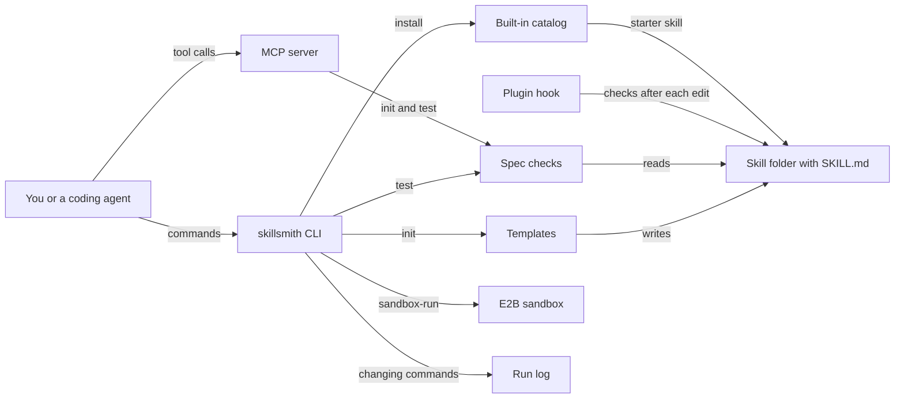

# How Skillsmith works

Skillsmith helps you create, test and vet skills for coding agents.
A skill is a folder with a `SKILL.md` file that tells an agent when to act and which steps to follow.
Skillsmith scaffolds new skills, checks them against the skill format, and installs starter skills.
It works as a command-line tool, an MCP server and a Claude Code plugin hook.
It is for people who write skills and for agents that write or install them.

## The parts

The CLI is [src/index.ts](../src/index.ts), and each command lives in [src/commands/](../src/commands/).
`init` writes one of three templates from [src/templates/index.ts](../src/templates/index.ts).
The templates are basic, advanced, and one for a skill that wraps an MCP server.
`test` in [src/commands/test.ts](../src/commands/test.ts) runs the spec checks on a `SKILL.md`.
`install` in [src/commands/install.ts](../src/commands/install.ts) writes a starter skill from a small catalog built into the code.

The same checks run in three more places.
The MCP server in [src/mcp/server.ts](../src/mcp/server.ts) keeps its own copy, used by two of its four tools.
MCP, the Model Context Protocol, is the standard way an agent calls outside tools.
The plugin hook [hooks/check-skill.cjs](../hooks/check-skill.cjs) runs the error checks after an agent writes a `SKILL.md`.
`sandbox-run` in [src/commands/sandbox-run.ts](../src/commands/sandbox-run.ts) runs them as a shell script inside an E2B sandbox.
That way an untrusted skill is parsed on a short-lived virtual machine, not on your computer.
[src/observability/runs.ts](../src/observability/runs.ts) appends one line per changing command to `~/.skillsmith/runs.jsonl`.

## What happens when you run it

The main flow is `skillsmith init my-skill`, then `skillsmith test my-skill`.

1. [src/index.ts](../src/index.ts) parses the command. It wraps `init` so the run is logged when the process exits.
2. [src/commands/init.ts](../src/commands/init.ts) asks for a kebab-case name and a template if you did not pass them.
3. It writes the template files from [src/templates/index.ts](../src/templates/index.ts) into a new folder. The basic template is one `SKILL.md` with front matter, a title, and When to Use, Steps, Example and Output Format sections. The advanced template adds `knowledge/` and `examples/` folders.
4. `skillsmith test` runs [src/commands/test.ts](../src/commands/test.ts), which finds the `SKILL.md` in the folder.
5. It checks for front matter with `name` and `description`, because agents find a skill by those two fields.
6. It checks for an H1 title, a trigger section such as `## When to Use`, and a steps section such as `## Steps`.
7. It rejects absolute paths from one machine, and it measures size. Over 2,000 words is a warning. Over 3,000 words is an error.
8. A missing Example or Output section, or a heading with nothing under it, is a warning.
9. It prints the results, or JSON with `--json`. It exits with code 1 on any error, and on any warning with `--strict`.

## Extending it

- **A new check.** Add it to [src/commands/test.ts](../src/commands/test.ts) and to `validateContent` in [src/mcp/server.ts](../src/mcp/server.ts). If it is an error, add it to [hooks/check-skill.cjs](../hooks/check-skill.cjs) and to the shell script in [src/commands/sandbox-run.ts](../src/commands/sandbox-run.ts). Then add a fixture to `FIXTURES` in [eval/golden.eval.ts](../eval/golden.eval.ts). The agreement cases fail if one copy drifts.
- **A new template.** Add a function to [src/templates/index.ts](../src/templates/index.ts). Offer it in [src/commands/init.ts](../src/commands/init.ts) and in the `skillsmith_init` tool in [src/mcp/server.ts](../src/mcp/server.ts). Every template must pass `skillsmith test --strict`.
- **A new MCP tool.** Add it to the `TOOLS` list and to the switch in `handleRequest` in [src/mcp/server.ts](../src/mcp/server.ts). Cover it in [tests/mcp-server.test.ts](../tests/mcp-server.test.ts).
- **A new catalog skill.** The catalog is written out three times. `list` reads [src/commands/list.ts](../src/commands/list.ts), `install` reads [src/commands/install.ts](../src/commands/install.ts), and the MCP server has its own list. Today they hold ten, five and eight entries, so add the skill to all three.
- **A new command.** Add a file in [src/commands/](../src/commands/) and register it in [src/index.ts](../src/index.ts). Wrap it in `audited` if it changes files.
- **A new skill for this repository.** Add `skills/<name>/SKILL.md` and list it in [skills/README.md](../skills/README.md). A golden case runs `test --strict` on every skill there.

Then run `pnpm build`, `pnpm test` and `pnpm eval`.
If the eval pass count goes up, raise `evals_passed` in [eval/baseline.json](../eval/baseline.json).

## Questions

**Does it need an API key or cost money?**
Skillsmith is free and MIT licensed.
It calls no model and needs no key for `init`, `test`, `list`, `install`, `publish` or the MCP server.
Only `sandbox-run` needs a key, `E2B_API_KEY`.
Each sandbox boot is a paid E2B action.

**Does any data leave the machine?**
Only with `sandbox-run`, which uploads the `SKILL.md` text to an E2B sandbox.
`publish` uploads nothing, because the shared registry is not live yet.
It validates the skill and suggests sharing it through GitHub instead.
The run log stays in `~/.skillsmith/runs.jsonl`, or in the file named by `SKILLSMITH_RUNS_FILE`.

**How does it improve itself?**
[dsip.json](../dsip.json) puts it at level L2, which means a scheduled loop runs and writes proposals.
Every day [.github/workflows/improve.yml](../.github/workflows/improve.yml) runs [scripts/improve.mjs](../scripts/improve.mjs).
The script runs the golden evals and compares the pass count with [eval/baseline.json](../eval/baseline.json).
It lists failing cases and outdated dependencies, and on the CI runner it tries the in-range updates.
It writes a proposal to `logs/improve/latest.md`, uses no model and no secret, and merges nothing.
It is not L3, because the loop does not change its own steps.

**How do I run its tests or evals?**
Run `pnpm install` and `pnpm build` first.
`pnpm test` runs the unit tests in [tests/](../tests/).
`pnpm eval` runs the golden cases in [eval/golden.eval.ts](../eval/golden.eval.ts) against the built CLI, MCP server and hook.
[eval/README.md](../eval/README.md) lists what each case covers.

**What does it not do?**
It does not run a skill or judge whether its steps are good advice.
It checks structure: front matter, sections, paths and size.
There is no shared registry yet, so `install` writes a local starter, not a downloaded skill.
[src/mcp/registry.ts](../src/mcp/registry.ts) holds the client for a future registry, and no command calls it today.
